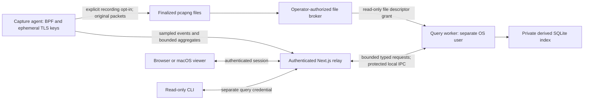

# JAM-255: local recorded-capture query service

Date: 2026-10-11; evidence and review refreshed 2026-10-13. Status: **completed spike; recommendation awaiting James’s adoption decisions**. Source baseline: `fce195e0d87dac6fb3d14cec5b459ab3b7efc141`. This spike changes documentation only; it does not authorize implementation, enable recording, or claim the service exists.

## Recommendation and alternatives

Recommend **option 3: a separate, unprivileged local query service**, initially indexing explicitly selected, finalized capture files. Keep the existing sampled live feed and bounded agent aggregates. Put the query API behind authenticated relay routes, with a read-only capability distinct from capture control. Use SQLite as the proposed first index, subject to dependency approval and a benchmark of the production build. The recommended boundary uses a different OS identity and restricted file grants. A same-user sandbox alternative requires separate approval and demonstrated denial of the same sensitive access; a second process alone provides no such boundary.

| Option | Benefit | Cost and security consequence | Decision |
| --- | --- | --- | --- |
| 1. Existing feed plus agent aggregates | Smallest change; bounded live counters/top-N remain useful | Cannot recover packets omitted by the 100 events/s limiter or browser eviction; cannot provide complete historical drill-down, stream bytes or arbitrary historical filters | Keep for live monitoring, insufficient as the history solution |
| 2. Query commands on capture control | Direct access to current decoder state | Adds query planning, persistent storage and resource contention to a process with capture access and ephemeral TLS secrets; the existing credential does not separate read and control roles | Reject for recorded queries |
| 3. Separate query service | Independent scheduling, cancellation and failure; recorded queries need neither BPF nor TLS keys | Requires installation, identity separation, file grants, caller authentication and schema/version management | Recommend with the prerequisites below |
| 4. Query engine inside Next.js | Fewer processes and straightforward routes | Query/decoder resource failures affect SSE and control; relay already holds the agent credential and handles decrypted events; same process cannot isolate those from a parser compromise | Reject as the engine; retain relay as bounded authenticated gateway |

This is a local analysis boundary, not an internet-facing database or a fleet architecture decision. Existing `127.0.0.1` bindings and the Caddy/mTLS LAN entrance remain unchanged.

## What the repository actually provides

The evidence below was checked in source at the baseline; older issue descriptions and specifications are not implementation evidence.

| Evidence | Consequence |
| --- | --- |
| `capture-agent/src/main.rs` emits sampled packet events after recording; `app/page.tsx` retains bounded rolling arrays | Query results cannot be reconstructed from SSE. Live UI history is explicitly sampled/evicted. |
| `main.rs:3207` queues original packet bytes before decryption; `pcapng.rs:170` writes them directly | Recording does not persist the decrypted TLS output. It **does** persist original cleartext application bytes, potentially including credentials. JAM-255's “redaction before storage” premise does not describe the current raw writer. |
| `main.rs:3016` excludes malformed/unsupported non-IP traffic before recording; `main.rs:5521` excludes the live control socket; queue capacity is 4096 (`main.rs:1984`) | Even a fully indexed file is not necessarily a complete interface capture. BPF, snaplen, pauses, exclusions and writer drops must remain visible or unknown. |
| `pcapng.rs:182` writes original length equal to captured length; live timestamps use `SystemTime::now` (`main.rs:1551`); IDB is created from startup configuration | Existing files cannot reliably prove original wire length, snaplen truncation or later interface/filter changes. Preserve recorded values with provenance; do not fabricate the missing metadata. |
| `ring.rs:284` advances filenames; duration/total-size auto-stop exists, but no old-file pruning; free-space floor is 500 MiB | The older capture-file spec's wrapping retention/file-count claims disagree with implementation. Rotation is not a disk-retention policy. `bytes_written` also excludes file headers/statistics blocks. |
| `pcapng.rs:636` is a sequential reader; partial blocks error and replay stops at EOF | No random-access index, safe live tail protocol, immutable source ID or resumable query catalog exists yet. A `.partial` filename is not a committed-read contract. |
| Reader framing bounds are 16 MiB/block and 4096 interfaces/section; unknown blocks, including Decryption Secrets Blocks, are skipped after framing checks (`pcapng.rs:750`) | Reuse validated parsing, but do not copy unknown blocks, comments or secret blocks into the index. External files can contain secrets even though our writer does not generate them. |
| Packet IDs use process epoch/sequence (`main.rs:3243`); flow IDs are reusable five-tuples (`flow.rs:19`); replay discards EPB direction and lacks live ownership | Neither ID is a durable recorded-file key. Direction, process identity and completeness cannot be inferred from tuple order. |

Relevant existing tests include `no_disk_write_invariant`, `pcapng_roundtrip`, `replay_truncation`, `replay_compatibility`, the pcapng fuzz target, and ring unit tests. This spike's executed checks are listed in the measurement/validation section; listing a test here does not claim it was run.

## Privilege, data and authentication boundaries

**OS boundary.** Proposed production worker account: a dedicated installation-managed `nm-query` identity (name illustrative), never root, never a member of `access_bpf`, no Linux capture capabilities, no supplementary capture groups, no inherited agent sockets, TLS key files, relay/control credentials or arbitrary environment variables. Close inherited descriptors except explicit IPC/source grants. The worker has no outbound network access under a platform-enforced sandbox. A normal unsandboxed same-user child inherits access to owner-readable files and often capture groups: that is fault isolation only. A deliberately sandboxed same-user worker is a distinct alternative, compared below; it is not implicitly approved or an automatic fallback.

The account owns a configured `.data/query/` root with mode `0700`; databases, journals, WAL, shared-memory, temporary and crash-recovery artifacts are `0600`, with `umask 077`. Directory traversal permissions must let the service reach this root without exposing the rest of the checkout. A platform installer/launcher must establish and test the identity, directory ACLs and sandbox. If the installer cannot establish the recommended boundary, that deployment remains unavailable unless James explicitly selects a separately proven sandbox alternative; there is no automatic same-user fallback. Root/the privileged operator and a compromised authenticated relay remain trusted boundaries, not attacks this service can eliminate.

**Installation and alternative boundary.** Creating a dedicated worker identity and arranging its launch/grants requires an administrator-authorized installer on a standard macOS installation; cloning the repo and running the current developer commands will not provide this feature. Account lifecycle, updates/uninstallation and directory ACLs add product/operations work. Recommend that boundary because OS discretionary permissions deny owner-only files even if a worker's sandbox policy is imperfect; still require a sandbox and descriptor cleanup. James must decide whether that installation cost is acceptable.

| Threat | Dedicated OS identity plus sandbox (recommended) | Same-user worker plus verified platform sandbox (alternative) |
| --- | --- | --- |
| BPF/capture access | No capture group/capability, device access denied, inherited capture descriptors closed; installation tests prove denial | Same UID/group may otherwise permit BPF. Sandbox must deny device opens/ioctls/raw capture sockets, drop capabilities and close inherited descriptors; group membership alone is not a denial. |
| TLS key files/agent memory | Owner-only files denied by UID, cross-user memory access denied by normal OS boundaries, no inherited key descriptors; sandbox restricts accessible paths further | A narrow file policy must deny key-log paths even though UID permits reads; also verify process-memory/debug access is denied. File restrictions alone do not prove memory isolation. |
| Control token/other operator files | Owner-only files denied by UID; no token/environment inherited; protected IPC permits only typed query requests | Descriptor-only grants and a private writable container must deny other paths; ensure no broad home-directory or network entitlement, inherited token, or bypass through process inspection. If policy is missing/inactive, owner access returns. |
| Launch cost/failure | Admin install/account management; unavailable until verified | May avoid an extra OS account, but needs supported sandbox packaging/API, correct entitlements/kernel ABI, launch attestation and adversarial tests. Unavailable if enforcement cannot be established; no unsandboxed fallback. |

Possible mechanisms to investigate are a signed macOS App Sandbox helper with narrow entitlements/file grants, and Linux Landlock plus seccomp/capability restrictions. These are candidates, not verified equivalent implementations. Apple documents entitlement-based resource limits and user-selected file access; Linux documents ABI-dependent restrictions and warns that inherited descriptors need special care. [Apple App Sandbox](https://developer.apple.com/documentation/security/app-sandbox), [Apple file access](https://developer.apple.com/documentation/security/accessing-files-from-the-macos-app-sandbox), [Linux Landlock](https://docs.kernel.org/userspace-api/landlock.html). The implementation spec must verify deny cases on each supported OS, including subprocess/inherited-descriptor and process-inspection paths. The same-user alternative must prove every denial independently before James could select it; a claimed sandbox flag is not evidence.

**At rest.** The proposed SQLite metadata index is plaintext at rest; `0600` files and `0700` directories restrict OS access but do not encrypt the database, WAL, temporary files or backups. The worker does not acquire TLS key material to protect storage. Reliance on platform full-disk encryption, backup encryption/exclusion, and the treatment of an unlocked or stolen host must be an explicit deployment policy, chosen with JAM-231/JAM-233 before persistent indexing is adopted. This spike establishes neither encrypted indexes nor secure erasure. Session-scoped cache deletion also cannot erase SSD remnants or snapshots. An authenticated operator, administrator, or compromised relay able to access the store can learn the indexed metadata.

**Source grant.** Original captures can remain `0600` and owned by the operator. A narrow broker, outside the packet/query parser, accepts an explicit operator selection, opens a regular finalized file read-only, rejects symlinks/devices/path traversal using descriptor-relative no-follow checks, validates owner/type/size, and passes the descriptor over protected local IPC. It neither loosens source permissions nor accepts an arbitrary path from a query. Record a capture UUID, immutable generation, file identity and size; detect replacement/truncation/modification, revoke the grant and invalidate its index. Export/offline-file access requires the same grant. No source deletion is authorized by granting read access.

First release targets finalized outputs of this agent; hostile packet contents remain untrusted. A filename/owner cannot prove origin, and there is no trusted writer manifest today. Every granted file therefore receives a bounded structural preflight before any indexing, regardless of claimed origin: reject DSB/secret-bearing blocks and unsupported formats; copy no opaque blocks into derived artifacts. A trusted writer catalog/manifest is a prerequisite for any future origin-based exemption. Third-party import remains a separate feature gate with explicit incidental-secret policy. A preflight cannot certify arbitrary packet payloads secret-free. Reuse decoding code through a privilege-free library boundary rather than launching a second capture agent or duplicating its protocol semantics.

**Stored fields.** Store allowlisted packet-header metadata, offsets and provenance; no TLS secrets, decrypted bodies, `DecryptedStore` data, raw payload BLOBs, arbitrary summaries, comments, key logs or external secret blocks. Decoded application fields are excluded until a reviewed allowlist applies `redact.rs`-equivalent redaction *before* index/WAL/temp serialization, with regression tests. Metadata such as IPs, ports and hostnames is still sensitive. Original capture files retain original cleartext, under the existing explicit recording consent; the derived index does not make those files redacted. Initial packet detail exposes header metadata only. Payload/Follow Stream emission stays unavailable until its own protocol-specific response and redaction contract is reviewed: `redact.rs` handles known headers/bearer-shaped values, not arbitrary binary bodies. Escaping is not credential redaction. That follow-up must bound, redact and escape emitted content and prohibit persistent decoded caches. Decrypted Follow Stream remains solely in the existing ephemeral store and rendering gate; no disk index, CLI route or fallback can supply it.

**JAM-196 verification.** Agent socket authentication exists (`main.rs:3791`, `lib/agent-auth.ts`, `lib/agent-client.ts`) but authenticates the relay to the agent, not HTTP callers. `/api/control` uses the cross-site check and `/api/stream` builds SSE without caller credentials. `lib/same-origin.ts:50` deliberately accepts requests without Origin/Fetch Metadata; Host checking is another browser defense, not user authentication. Thus JAM-196 remains a prerequisite. The existing decrypted gate accepts an absent mTLS header on the local path; do not reuse that as proof of caller identity. Caddy validates client certificates and overwrites its verification header; the native viewer locks navigation and presents its client certificate. Those protections do not authenticate an arbitrary local CLI to the relay.

**Proposed callers.** JAM-196 must define an authenticated local bootstrap for browser/native sessions, short-lived HttpOnly/SameSite session cookies, CSRF checks for mutations, expiry/revocation and a separate explicit CLI query credential. Native LAN access additionally retains its existing mTLS certificate and navigation lock; mTLS and the application session both apply. A CLI read capability cannot start recording, alter BPF, register decryption, or retrieve decrypted content; do not reuse the agent's all-control token. Never put credentials in URLs, logs or profiles. Relay routes authenticate before reading a body or resolving a capture grant; apply Host/origin defenses as well. Protected Unix-domain IPC verifies peer identity and uses a per-launch capability; the worker receives neither the relay's control token nor browser cookies. Deployment and bootstrap details require a separate security-reviewed implementation spec.

## Query contract and bounded failure

Proposed routes: `GET /api/query/captures` for the authorized catalog; `POST /api/query/packets`, `/api/query/series` and `/api/query/flows` for typed read queries; bounded `GET /api/query/captures/{id}/packets/{ordinal}` for detail. POST carries a read query because filter expressions should not enter URL/access logs. Grants, cancellation and lifecycle management are authenticated mutations, separate from capture control. No raw SQL, filesystem path, table name, extension name or arbitrary aggregation expression is accepted.

Extract a shared typed filter AST from `lib/display-filter.ts` (currently it emits predicate closures). Validate on the server independently of the UI; allowlist fields, operators, result columns and sort keys; bind values as SQL parameters. Preserve the existing 2048-character, 512-token, 64-depth and 128-set-member bounds. Unknown/missing comparisons currently return false, including inequality; negation of that result returns true. Translate two-valued semantics explicitly instead of leaking SQL NULL behavior. Preserve literal `contains` rather than SQL wildcard interpretation, and JS case-folding behavior rather than assuming SQLite ASCII `NOCASE` is equivalent. Differential tests must prove evaluator/SQL parity, including unknown fields, types, Unicode, null/missing and negation; unsupported fields are explicit errors, not silently ignored filters. AST compilation does not authorize general SQL.

Proposed initial limits are tuning candidates, not adopted retention policy:

| Resource | Initial candidate and pressure behavior |
| --- | --- |
| Request/result | 64 KiB request; 200 rows/page default, hard maximum 1000 and 1 MiB serialized response; a too-large single row reports unavailable/oversize |
| Scheduling | Two active queries globally, one per principal; queue eight globally; reject excess with retryable busy, queue deadline 1 second; one importer; all buffers charged by allocated capacity |
| Execution | 1-second interactive deadline with progress cancellation; 2-second external worker watchdog if cancellation stalls; close cursor/transaction on disconnect; timeout returns a typed error, never an apparently complete subset |
| Query worker | 256 MiB target/hard enforced allocation budget including decoder state, results and caches; 32 MiB SQLite page-cache target; enforce total process resource ceiling outside SQLite and restart a failed worker with a bounded retry count |
| Parsing/import | Retain 16 MiB block and 4096-interface bounds, checked arithmetic before allocation; aggregate interface-name/state budget, bounded 5000-row batches and a 32 MiB input/batch budget; stop at a committed packet boundary on pressure |
| Disk | Candidate 2 GiB **total derived artifacts** quota including DB/WAL/temp/rebuild space, plus reserved headroom; reserve before writes and stop indexing on quota/low disk. Never drop source packets or delete user captures to make an index fit |

The process-memory ceiling needs platform-specific enforcement verified by adversarial tests; SQLite cache size is not a total-memory limit. The measured largest full aggregate exceeds the proposed interactive deadline: use bounded precomputed series/top-N or a separately approved cancellable job budget, not a larger default timeout. Unsupported sort/filter plans must fail predictably within budget, not promise every field is indexed.

Use stable ordering `(sort value, packet ordinal)` and keyset cursors bound to principal, capture generation, filter/sort/columns hash and indexed watermark. Each page is a short read transaction; do not hold a database snapshot while the user is idle. Later ingestion is excluded from that cursor's watermark. Changed/evicted captures return `source_changed`/`410 Gone`, expired cursors require an explicit new query, and partial coverage is metadata. Counts/aggregates label their window and completeness. Timestamps use an explicit unit and lossless integer representation on JSON boundaries; flow identity includes capture generation, endpoint direction and a versioned connection-generation rule, not just the five-tuple.

Parsing corruption is terminal for the affected source generation; return the last validated/indexed prefix with an explicit error only when the caller requested partial coverage. A crash leaves committed index transactions reusable after integrity/version validation, otherwise rebuild from the granted immutable source. Disk pressure pauses import and reports backlog; resume requires room and a valid grant. Revocation cancels outstanding queries, closes file descriptors and clears source-scoped caches. Only derived data is eligible for authorized cache eviction; tombstone catalog entries before removal, and report deletion failures rather than claiming erasure. SQLite/free-space deletion is not secure physical erasure on an SSD or backup.

## Recording, live data and retention

No always-on recording is required. With recording off, the UI offers the current sampled live view and says recorded history is unavailable. While recording, v1 continues that live view and indexes a segment **after finalization**; history lags by at least rotation plus preflight/import time. It reports recording state, source span, indexed watermark, lag and unknown/drop reasons. The current single growing file becomes queryable after stop. Do not silently treat live samples plus a file as a gap-free union.

An honest coverage label is “X validated packets indexed through ordinal Y; recorded timestamp span Z; index complete/paused/error.” Interface-capture completeness is a separate, generally unknown fact. Existing live cumulative counters cannot establish file-scoped drops/exclusions, effective filter epochs or missing original wire lengths; the reader does not currently expose stored ISBs either. Report those unknowns rather than attach a live counter snapshot to a file as if it were durable provenance.

A later committed-segment manifest can support indexing during recording. It needs crash-safe finalization, configuration epochs, trustworthy drop/truncation/original-length metadata and a bounded backlog policy. Partial-block retry, file rotation/replacement and checkpoint recovery need dedicated tests before `.partial` tailing. The benchmark's between-commit reads establish only database prefix visibility, not a production file-tailing protocol or concurrent capture capacity.

Propose a disposable derived cache with explicit operator-selected captures, a 2 GiB starting quota, session-scoped grants and no automatic raw-file deletion. Whether indexes persist across restart, their age limit, source retention duration/bytes and deletion/backup policy are **James's decisions**, coordinated with JAM-233. A next-session rebuild is the conservative initial proposal. Fleet's recorded three-day traffic-window choice in JAM-216/JAM-233 is not automatic permission to retain local raw packets for three days. Profiles store preferences separately from traffic, cannot restore grants or enable recording/decryption/enrichment, and do not carry credentials.

## Store choice and measurements

SQLite is the proposed local index because the workload combines packet lookup, time/flow range pages and a single importer. Its local application-storage role fits this boundary; a fleet service should not share this file over a network filesystem. [SQLite appropriate uses](https://www.sqlite.org/whentouse.html).

WAL permits readers alongside a writer, but long readers can obstruct checkpoints and grow disk use. Bound read transactions and account for every sidecar. The measurement runtime is SQLite **3.51.0**, which predates the WAL-reset fix: production must pin a patched version (3.51.3+ or a documented patched branch) and repeat the workload. The harness has one writer/checkpointer and no concurrent writing/checkpointing connection; this is measurement evidence, not dependency approval. [SQLite WAL documentation and fix](https://www.sqlite.org/wal.html).

DuckDB remains a candidate if measured analytic scans dominate. Its embedded mode supports writes within one process and multiple-process read-only access; changing that architecture is unnecessary here. Its default memory budget is 80% of RAM and only covers its buffer manager, so defaults cannot provide this service's resource boundary. DuckDB was not installed or benchmarked; no comparative speed claim is made. [DuckDB concurrency](https://duckdb.org/docs/current/connect/concurrency), [limits](https://duckdb.org/docs/current/operations_manual/limits).

A custom offset index would reduce the schema/dependency surface but must implement persistent identity, multiple sort orders, filtering, crash recovery, pagination and bounded aggregation itself. A single offset array cannot supply arbitrary filtered/sorted queries. No custom-index performance result was measured; prefer a reviewed store over creating a database engine in this project.

At the measured 6m database cost, a 2 GiB index quota holds at most about 12.82m rows before WAL/temp/rebuild space, about 128 seconds at 100k packets/s. The importer measured only about 32k packets/s. Whole-file per-packet indexing is therefore unsuitable as a general default for sustained high-rate links. Keep small explicitly selected finalized incident captures as v1 scope; separately measure operator-selected time/flow subsets and flow/metric rollups, including preflight/scan cost, before choosing a high-rate strategy. High-cardinality traffic can make the measured 4096-flow aggregate/index workload substantially worse.

Measurement results and limitations are in the companion [measurement record](2026-10-11-local-query-service-measurements.md). They select candidate budgets, not sustained home/office/datacenter capacity claims. No database dependency, service or benchmark harness is added to production.

## Relationships and proposed follow-up issues

JAM-90/JAM-91 define observation identity, versioned values, units, unknowns and provenance: align the query envelope with them before freezing a schema. Packet offsets and packet-specific fields remain a separate entity family, not fabricated host metrics. JAM-117 should use the same local storage service/lifecycle where suitable, with separate bounded numeric-metric tables and retention classes; it must not imply raw-packet retention or make packet history mandatory for metrics. One service need not mean one file or one retention policy.

JAM-162 keeps bounded live endpoint/conversation maps and user-selected top-N in the agent, as James already decided. Recorded top-N is computed by the query service over an explicit source/window; it cannot replace live rankings when recording is off. JAM-216's proposed fleet ingest/uplink and JAM-246's server-side fleet rollups/RBAC remain separate deployment and scale work. Reuse typed query concepts where useful; do not equate six million local synthetic rows with multi-host WAN/carrier capacity.

Propose these separately gated implementation issues, in dependency order; no implementation gate is approved by this spike:

1. Finish JAM-196 caller authentication and read/control capabilities for browser, native and CLI; negative tests against headerless local callers and credential reuse.
2. Specify/install the query OS identity, IPC and descriptor-grant broker; test actual BPF/key/control-token denial and sandbox escape attempts on macOS and supported Linux.
3. Specify source identity/completeness and immutable capture catalog; reconcile the recorder's length/configuration/drop/rotation metadata with verified behavior, without widening the existing wire protocol casually.
4. Extract the privilege-free decoder and typed filter AST; fuzz file/AST parsers and differentially test existing filter semantics and redaction/no-disk invariants.
5. Add the approved, patched store and bounded index/query API; repeat benchmarks with real/mixed fixtures, production decoder, concurrent capture/UI, high-cardinality flows, cold-cache controls, disk exhaustion and cancellation under load.
6. Define JAM-233 local raw/index/metric/profile retention classes, quotas, revocation, backup and deletion behavior; implement without deleting operator files by implication.
7. Add the analysis/CLI surfaces below, then evaluate committed-segment live indexing and fleet-specific storage separately. Before high-rate deployment, benchmark bounded time/flow selection and rollup-only indexing against whole-file import, including high-cardinality attack workloads, bulk-load-then-build-indexes, preflight scan cost, backlog and explicit coverage. This is a proposed follow-up, not a claim of WAN/datacenter support.

| Blocked issue | Consequence of this recommendation; remains proposed until adopted |
| --- | --- |
| JAM-17 Follow Stream | Read bounded original recorded bytes through grants and versioned reassembly, preserving gaps/direction/conflicts. Keep decrypted data ephemeral and gated; an index alone is not a reassembler. |
| JAM-18 IO graph | Query bounded time buckets over a selected recorded source, with filter parity, numeric units/provenance and packet drill-down. Live sampled graphs label their coverage; choose bounded bin counts. |
| JAM-19 TCP graphs | Retain/derive sequence, ACK, window and directional samples from recorded packets. Define sequence wrap, retransmission/RTT ambiguity and downsampling before drawing; old five-tuples cannot identify an entire durable stream. |
| JAM-20 Flow ladder | Stable recorded packet IDs enable pagination and selection outside the browser buffer. Bulk grouping is bounded and carries count/span/coverage; labels are redacted and escaped. |
| JAM-28 Profiles | Separate declarative preferences storage/schema from capture data and permissions. A profile may refer to a saved filter, never restore source grants or enable capabilities. This task does not require recording. |
| JAM-29 Query CLI | Read-only authenticated API and shared decoder/filter semantics for recorded files; CLI has no decrypted or control capability. Live mode remains a bounded sampled subscription with an explicit horizon, not an unsampled default query. Define no-match/error exit codes and safe CSV/TSV output. |
| JAM-117 Historical metrics | Align with JAM-90/91 and share the storage service where useful, but use numeric metric tables with distinct retention/coverage. Raw packets and decrypted content are not metric history. |

## Decisions reserved for James

1. Adopt option 3 with a separate OS identity and authenticated relay prerequisite, accepting an administrator-authorized installer/account lifecycle on macOS and finalized-file history first; or choose a separately verified same-user sandbox alternative after its deny-case proof and packaging costs are reviewed. Neither option is implemented or an automatic fallback.
2. Keep recording opt-in (recommended). Any always-on mode needs explicit privacy approval; it is not implied by adding query routes.
3. Approve SQLite as a new pinned, patched dependency, then choose its implementation binding in the follow-up spec. No dependency was installed here.
4. Approve or revise initial cache/retention policy: session-scoped grants, rebuildable derived cache up to 2 GiB, no automatic raw-file deletion; choose any persistent index age limit and raw-file retention explicitly, and decide the required platform disk/backup encryption policy for plaintext raw captures and derived metadata.

5. Choose the high-rate default: explicitly bounded incident time/flow selection, rollup-first indexing, or continued sampled monitoring with optional finalized incident captures. The measured importer/quota do not support unrestricted whole-file indexing at sustained datacenter rates; selection and scan costs need follow-up measurement.

The recommendation and blocked-issue consequences are review material, not an adopted architecture or evidence that those issues can start implementation.

## Security-plan review and validation

Checklist: [security-plan-review-checklist.md](../../security-plan-review-checklist.md). This is a design review, not verification of an implemented service. Inputs/allocation bounds, per-owner/global budgets, cancellation and failure semantics are specified above. Packet overlap/reordering must inherit the reviewed reassembly policy per direction; conflicting or missing bytes cannot yield apparently complete content. An attacker can send expensive/malformed traffic or force high cardinality to consume the import budget; the result must be explicit gaps/backlog/denial of service rather than exposure of keys or unbounded capture-loop work.

Cryptographic derivation/record nonces are not applicable: this service does not decrypt. Authentication-token generation/comparison/cleanup will be reviewed in JAM-196, using established libraries and constant-time secret comparisons. Query deadlines use monotonic elapsed time; analysis uses recorded capture time and replay-aware rules, never wall time for RTT/flow aging. No capture-wire changes are made in this spike. New availability/coverage events must be bounded, one-shot per reason/source generation where possible, and cannot include captured content in error strings.

Implementation remains gated on tests for limits and limit+1, malformed/truncated/changed files, allocation capacity, revocation/cleanup, plaintext/secret exclusion from every persistent artifact, filter parity, auth cross-capability rejection, time wrap/order, fuzzing and crash/quota recovery. Zeroization of transient sensitive fields and the limits of library-owned copies must be tested/documented; the Python measurement harness is not a secret-handling implementation. Independent review findings and actual executed checks are recorded with the measurements and in `.ai/TEST_STATUS.md`.

### Checklist disposition (2026-10-13)

**Pass** below means the proposed design addresses the item; it does not mean a query service exists or its enforcement was tested. **N/A** means this documentation spike creates no such code path. Independent security review checked the source assertions and measurement evidence, found a missing plaintext-at-rest disclosure, and confirmed the added disclosure and reserved deployment decision resolve it. No other findings remained. Claude Code cross-review requested corrections to evidence references/reproducibility, high-rate consequences and OS-boundary alternatives. These corrections were checked by Claude Code, who approved the revised draft on 2026-10-13 at 11:50 EDT (Slack message `1791906618.440619`). The optional suggestion to attach the ephemeral harness to Linear is nonblocking and remains James’s decision.

| Checklist item | Disposition and evidence / remaining verification |
| --- | --- |
| 1: lengths before allocation | Pass (design): parser/block and request/batch caps, checked arithmetic; hostile limit/limit+1 tests required before implementation. |
| 1: per-stream/owner/global capacity | Pass (design): page/result, principal/global scheduling, input, process and total-artifact budgets; actual platform enforcement remains unverified. |
| 1: reordering/overlap | Pass (design): existing directional reassembly policy must be preserved; Follow Stream is a separate bounded contract, not supplied by the index. |
| 1: parser recursion / wrap | Pass (design): filter bounds preserved; packet/sequence handling inherits the reviewed decoder; extraction requires fuzz/differential tests. |
| 2: terminal/recoverable failures | Pass (design): corruption terminal for a source generation; pressure pauses a committed prefix; crash recovery requires integrity/version checks. |
| 2: incomplete/unauthorized output | Pass (design): authenticate before grants/queries; partial coverage only by explicit request with errors/provenance; no apparently complete subset. |
| 2: per-direction state | Pass (design): capture/connection generation plus direction; no five-tuple-only durable stream identity. |
| 2: attacker effects | Pass (design): hostile content/high cardinality can exhaust bounded import budgets; denial/backlog is explicit and isolated from capture. |
| 3: crypto algorithms / nonces / derivation | N/A: the worker performs no TLS decryption or new cryptography; application authentication is JAM-196. |
| 3: constant-time secret comparisons | Pass (design requirement): authentication uses established libraries/constant-time comparisons; token lifecycle tests belong to JAM-196. |
| 4: scoped ownership / cleanup | Pass (design): per-launch IPC capability and per-principal grants; revocation closes descriptors/cursors and clears caches. Implementation cleanup tests remain required. |
| 4: zeroizing/redacting types | Pass (design requirement): no secret-bearing summaries/fields in storage or errors; transient sensitive data and library-copy limitations require explicit tests in decoder extraction. |
| 4: zeroization tested | N/A for new code: no new secret-handling implementation. Existing no-disk tests ran; they do not establish a future worker's zeroization. |
| 4: decrypted content gate / no disk | Pass (design): index/CLI cannot access the decrypted store; existing no-disk and gate/export tests pass. Every new persistent path requires its own regression test. |
| 4: secret retention/time cap | Pass (design): no TLS secrets stored; session-scoped grants and short-lived/revocable caller capabilities. Authentication TTL details remain a prerequisite spec. |
| 5: time | Pass (design): query cancellation uses monotonic elapsed time; analysis uses recorded capture time/replay-aware rules. No live/replay timestamp code changed. |
| 6: wire synchronization | N/A: no wire changes; future coverage/event additions require the coordinated contract update. |
| 6: bounded one-shot status | Pass (design): source/reason scoped bounded diagnostics with no captured content; future event flooding tests required. |
| 7: tests-first/boundaries | N/A for implementation: documentation only. Existing security/data tests and measurement correctness were checked; new worker boundaries must be shown failing before implementation. |
| 7: fuzz coverage/CI | N/A for this diff: no new parser/reassembler. Extracted decoder/AST/import paths require fuzz targets in their implementation PRs. |
| 7: reviewer evidence | Pass: independent reviewer used source reads, JSON/hash checks and official SQLite docs; did not rerun suites or benchmarks. Implementer-run commands/results are in the companion measurement record and TEST_STATUS. |

The full TypeScript runner currently reports an existing WHOIS fixture socket error despite every test assertion passing. See the measurement validation record; this spike does not claim a clean full TypeScript run or authorize unrelated test changes.
